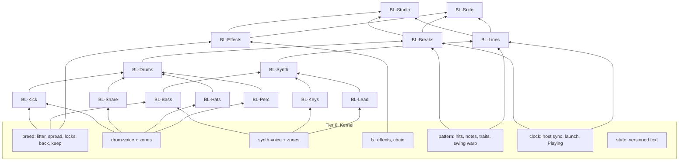

# Bloodline module map (draft)

**Status:** first draft, for discussion. Nothing here is decided until it moves to [decisions.md](../business_plan/decisions.md).

**The goal:** build Bloodline as modules, each made from the ones below it, so that BL-Kick goes into BL-Drums, BL-Drums goes into BL-Breaks, and BL-Breaks goes into BL-Studio. Each module should work as a product on its own, and as a building block for the next one up.

## The tiers

| Tier | What it is | Examples | Is it a product? |
| --- | --- | --- | --- |
| 0. Kernel | Libraries with no UI and no JUCE: breeding, voices, effects, patterns, clock, saving | `breed`, `drum-voice`, `synth-voice`, `fx`, `pattern`, `clock`, `state` | No |
| 1. Sound | One voice, one zone, one litter, one keep row | BL-Kick, BL-Snare, BL-Hats, BL-Perc; BL-Bass, BL-Keys, BL-Lead, BL-Pad, BL-Pluck | Yes, as small singles |
| 2. Instrument | Several kept sounds played together | BL-Drums (a kit of pads), BL-Synth (kept sounds on keys), BL-Effects (a bred chain) | Yes |
| 3. Player | An instrument plus bred loops that play it | BL-Breaks (BL-Drums plus drum loops), BL-Lines (BL-Synth plus note loops: today's Synth 2) | Yes |
| 4. Workspace | Several players with effects, as tracks or as one bred whole | BL-Studio (tracks, clips, effects), BL-Suite (everything generated and bred together) | Yes, at the top of an album or the discography |



## How the tiers connect

Five contracts make the tiers fit together. If every module keeps to them, any tier can be built from the one below without copying code.

1. **Genome.** Every bred thing (a drum, a synth sound, an effects chain, a drum loop, a note loop, a whole song) is plain data with three operations: fresh (from a zone or style), mutate (by spread, respecting locks) and cross. The one `Litter` (today `plugins/shared/breed/litter.h`) breeds any of them: four candidates, Breed, Again, Cross, Back, New, and spread that narrows and widens.
2. **Kept item.** What passes between tiers: a genome, its label ("Kick 3", "Bass 1") and where it was bred. A kick kept in BL-Kick loads onto a BL-Drums pad. A kit kept in BL-Drums loads into BL-Breaks. A loop kept in BL-Breaks becomes a clip in BL-Studio. Kept items are the currency of the whole family.
3. **Sound.** A genome turned into a voice: `trigger(note, velocity, time)`. Drums and synths look the same to a player.
4. **Pattern.** Events in a time window: `events(from, to) -> (time, target, velocity, length)`. A drum pattern's target is a lane, and the lane picks a kept pad by its label. A note pattern's target is a pitch on one kept sound. Swing as a warp of time belongs here.
5. **Clock.** Host position to loop position: follows the host's bar while it plays, runs on its own when it is stopped, launches on the next bar, and has the explicit Playing switch.

Saving follows the same shape: each module saves its own section of versioned text, and a parent nests its children's sections. A BL-Breaks state is a BL-Drums state plus loops, and a BL-Studio state is several of those plus effects and clips.

**Moving kept items between plugins in a DAW.** An AU cannot send MIDI to another track, which is why Breaks 2 and Synth 2 put the sound and the loop in one plugin. Files can still travel. One idea is a shared Bloodline library folder (for example `~/Music/Bloodline/`) where every plugin saves its kept items and can open anyone else's. Then a kick bred in BL-Kick appears in BL-Drums' pad menu without being dragged.

## What exists today, by tier

| Tier | Built | Where | Notes |
| --- | --- | --- | --- |
| 0 | Litter | `plugins/shared/breed/litter.h` | Shared, generic. |
| 0 | Drum voice, settings, zones | `plugins/bloodline-drums/core` | Reused by Breaks and Breaks 2 by adding its files to their CMake targets. |
| 0 | Synth voice, patch, zones, riff | `plugins/bloodline-synth/core` | Reused by Synth 2 the same way. |
| 0 | Effects, chain, rack | `plugins/bloodline-effects/core` | Not yet reused by anything. |
| 0 | Patterns, player, Playing switch, keep rows | inside `bloodline-breaks-2/core` and `bloodline-synth-2/core` | **Copied twice.** The first thing to lift into the kernel. |
| 0 | Max breeder engine | `shared/breeder` (JS, ES5) | For the Max for Live spikes; a separate breeding implementation. |
| 1 | Kick Breeder, Snare Breeder | `devices/` (Max for Live) | Spikes of the sound tier. |
| 2 | Bloodline Drums, Drums 2, Synth, Effects | `plugins/` | JUCE spikes. |
| 3 | Bloodline Breaks, Breaks 2, Synth 2 | `plugins/` | JUCE spikes; Synth 2 is the first BL-Lines. |
| 4 | Bloodline Studio, Bloodline Suite | `web/` | Browser sketches on their own JS engine (`web/bloodline-engine.js`). |

## Sketch, then build

Decision 3 in the business plan says each sound is written once and built for both the browser and the plugin. The JS engine in `web/` is a second implementation, so it should stay what it is now: **a sketchpad** for trying a module's shape in minutes. Products come from the kernel. The plain C++ is compiled with Emscripten for each plugin's free browser version, and wrapped in JUCE for the plugin.

## A possible layout

```
bloodline/
  kernel/      breed, drum-voice, synth-voice, fx, pattern, clock, state   (C++17, no JUCE, tested)
  ui/          tiles, keep rows, settings with locks, drum grid, piano roll, spread, transport   (JUCE)
  web/         Emscripten bindings for the kernel, and the browser shell each product page uses
  products/    bl-kick, bl-drums, bl-breaks, bl-lines, bl-effects, bl-studio, ...   (thin: wiring and layout only)
sketches/      the JS engine and the HTML sketches (today's web/)
```

A product folder should be small: which kernel modules it uses, its layout, and its saved state. If a product needs real logic, that logic probably belongs in the kernel.

## A possible order

1. Lift patterns, the player, the clock and keep rows out of Breaks 2 and Synth 2 into the kernel, with their tests. Breaks 2 and Synth 2 then become the first thin products.
2. Write the kept item and state contracts, and the shared library folder.
3. Build the UI kit from the components Breaks 2 and Synth 2 already have.
4. Build BL-Kick as the first Tier 1 product on the kit, with its browser version through Emscripten. It is the smallest whole slice: kernel, UI, plugin, browser.
5. Grow upwards: BL-Drums from BL-Kick and its siblings, then BL-Breaks, then BL-Studio.

## Open questions

1. **Tier 1 granularity.** One plugin per drum (BL-Kick, BL-Snare and so on) or one BL-Drum with a zone switch? Singles suit the album model; one plugin is less to maintain.
2. **Moving kept items.** A shared library folder, dragging files, or both?
3. **The browser path.** Confirm C++ through Emscripten for products (Path A in the plan), or try Faust or Cmajor first (Path B)?
4. **BL-Suite.** Its own product, or a mode of BL-Studio?
5. **Names.** BL-Lines for the synth player? "BL-" as a family prefix, or the full "Bloodline" in plugin lists?
6. **Albums.** Which tiers belong to album 1 (Bloodline Breaks), and which wait for later albums (the synth album)?
